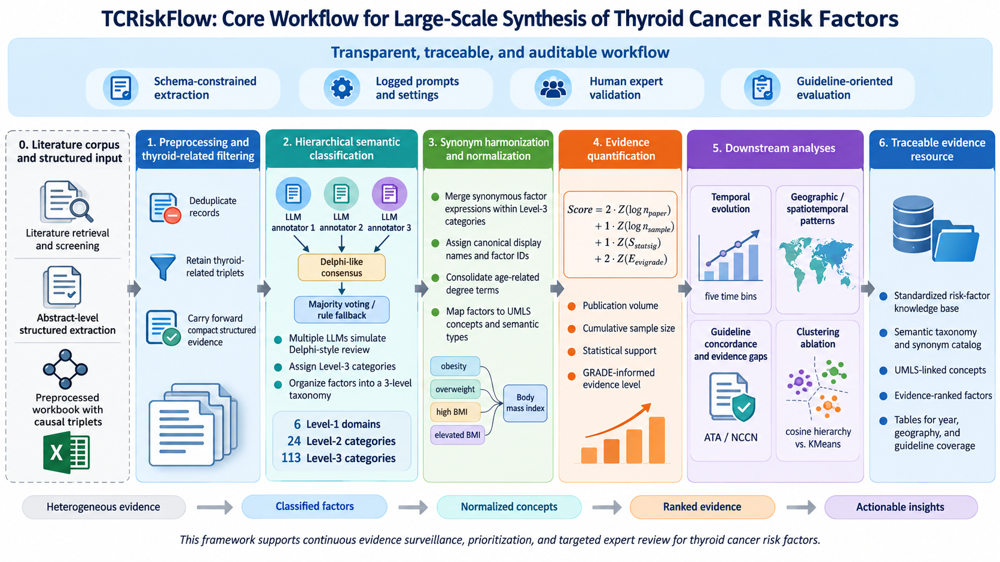

# TCRiskFlow —— 针对基于大模型的甲状腺癌风险因素抽取的方法代码库



[English](README.md)

**项目作者：** Yuqun Zeng
**邮箱：** zengyuqun@hmc.edu.cn
**对应论文：** TCRiskFlow，一个面向甲状腺癌相关风险因素大规模综合的模块化大模型框架（含结构化抽取、层级语义分类、同义词归一化、证据量化与指南导向评估）。

本仓库是论文方法的公开可运行实现。它把宽表格式的预处理工作簿（`preproc_thca.xlsx`）转化为可追溯、可计算的证据资源：风险因素被划分到三级分类体系、归并为同义词组、匹配 UMLS 概念，并通过一个复合证据分数驱动时间、地理与指南导向分析。

仓库内置演示样例（前 100 篇论文 + 抽样的同义词文件），无需任何 API Key 即可跑通全流程。

---

## 仓库覆盖的能力

| 能力 | 论文章节 |
| --- | --- |
| 按标题去重 | Data Source and Preprocessing |
| 甲状腺相关三元组筛选 | Structured abstract extraction module |
| 三级语义分类 | Semantic taxonomy construction module |
| 同义词归一化（按 Level-3） | Synonym aggregation and normalization module |
| UMLS 标准化匹配 | Synonym aggregation and normalization module |
| 复合证据分数 + 年份/大洲/分组统计 | Evidence quantification module；Temporal and spatiotemporal evolution analyses |
| 指南一致性与差距分析 | Guideline-oriented concordance evaluation and gap analysis |
| 聚类对照实验（余弦层次聚类 vs. KMeans） | Clustering ablation test |

本仓库不包含（位于本仓库上游）：WOS 检索、语言/文献类型/摘要筛选，以及产出预处理工作簿中 `causal_triplets_*` 列的初始大模型结构化抽取。

---

## 论文方法与代码对应关系

论文的每个方法步骤对应 `src/thca_risk_factor_toolkit/` 下的一个模块。下表列出论文章节、原文表述、对应脚本及运行参数。

| # | 论文章节 | 论文原文要点 | 脚本 | 关键参数 |
| --- | --- | --- | --- | --- |
| 1 | Data Source and Preprocessing | "title/abstract-based deduplication yielded unique records"（按标题/摘要去重） | `step05_deduplicate_title.py` | 去重键 = `TI`，`keep="first"` |
| 2 | Structured abstract extraction module | "causal_triplets ... constrained by a JSON schema"；"Fields without sufficient information ... null" | `step07_count_thyroid_triplets.py` | 疾病字段含 `thyr`（忽略大小写）；非甲状腺三元组前移压缩 |
| 3 | Semantic taxonomy construction module | "DeepSeek-V4 Pro and Doubao ... majority voting ... Level-3 assignments" | `step08_factor_classifier.py`、`step08_extract_classify.py`、`hierarchy.py` | 单阶段 Level-3 分类；`factor-subcategory.json`（6 个 Level-1 / 24 个 Level-2 / 113 个 Level-3）；LLM 关闭时走规则兜底 |
| 4 | Synonym aggregation and normalization module | "synonym harmonization ... within predefined Level-3 categories ... case-insensitive lexicographic rule" | `step09_group_synonyms.py`、`step09_merge_age.py` | 规范键按 `(长度, 词)` 排序；`factor_id = SHA-256(factor_key)`；Age 程度词合并 |
| 5 | Synonym aggregation and normalization module（UMLS） | "QuickUMLS ... overlapping_criteria='score' ... threshold 0.809 ... discard <0.90" | `umls_match.py` | `SIMILARITY_THRESHOLD = 0.90`；按 CUI 去重、保留最高相似度 |
| 6 | Evidence quantification module | "Score = w_num·Z[log(n_paper)] + w_size·Z[log(n_sample)] + w_statsig·Z(S_statsig) + w_evigrade·Z(E_evigrade)"；权重 `W_num=2, W_size=1, W_statsig=1, W_evigrade=2` | `factor_scoring.py`、`step10_factor_data.py`、`step10_factor_scores.py`、`step10_entry.py` | p 值权重 1.0/0.5/0.1；GRADE 高/中/低/极低 = 4/3/2/1；全局 Z-score 用 `ddof=0` |
| 7 | Temporal and spatiotemporal evolution analyses | "five predefined periods (before 2000, 2001–2010, 2011–2015, 2016–2020 and 2021–2025)" | `step10_factor_scores.py` | `YEAR_BINS` 含端点；按分数取 top-10 |
| 8 | Guideline-oriented concordance evaluation and gap analysis | "exact-group match ... shared-term match"；"Coverage = N_matched / N_total ×100%" | `step10_guidelines.py` | `guideline_match_policy="shared_term"`；覆盖率按 10%/5%/2%/1% 分位 |
| 9 | Clustering ablation test | "cosine average-linkage agglomerative ... k-means ... K = Level-3 类别数 ... ARI, NMI, purity, homogeneity, completeness, mapped macro-F1" | `ablation/`（详见 `docs/ablation_study.md`） | KMeans `random_state=42, n_init=20, max_iter=300, algorithm="lloyd"` |
| 10 | Statistical Analysis | "Counts and percentages ... medians with ranges ... χ², Cramér's V, NMI" | `statistics.py` | 文献计量表；详见 `docs/output_spec.md` |

---

## 快速开始

```bash
git clone <你的-github-仓库地址>
cd github_repo
bash scripts/install.sh
bash scripts/run_demo.sh
```

演示在 `data/sample/preproc_thca_demo_first100.xlsx` 上依次运行 Step 05 → 07 → 08 → 09 → 10，外加 UMLS 匹配与文献计量统计；Step 08 使用规则兜底，无需 LLM Key。

完整运行：把 `config.json` 中的 `input_xlsx` 改成完整工作簿路径、启用 LLM 配置后运行：

```bash
bash scripts/run_full.sh
```

### 运行聚类对照实验

```bash
python scripts/run_ablation_main.py
```

所需数据形式、两种聚类方法与各统计标签的计算方法见 [docs/ablation_study.md](docs/ablation_study.md)。

---

## 仓库结构

```text
github_repo/
├─ config.json / config.example.json
├─ data/
│  ├─ sample/
│  │  ├─ preproc_thca_demo_first100.xlsx
│  │  └─ 09_factor_label_associations_semantic_merged_v2_demo_first100.csv
│  └─ demo_resources/
│     ├─ factor-subcategory.json
│     ├─ umls_concepts_demo.csv
│     ├─ country_continent_reference.csv
│     └─ guideline/{ATA 2015, NCCN 2023}/*.json
├─ prompt/{en,zh}/*.txt
├─ scripts/
│  ├─ run_demo_pipeline_main.py
│  ├─ run_full_pipeline_main.py
│  ├─ run_ablation_main.py
│  └─ build_demo_sample_main.py
├─ src/thca_risk_factor_toolkit/
│  ├─ common.py, hierarchy.py, factor_scoring.py, config.py, path_utils.py
│  ├─ step05_deduplicate_title.py
│  ├─ step07_count_thyroid_triplets.py
│  ├─ step08_extract_classify.py, step08_factor_classifier.py
│  ├─ step09_group_synonyms.py, step09_merge_age.py
│  ├─ step10_factor_data.py, step10_factor_data_semantic.py
│  ├─ step10_factor_scores.py, step10_guidelines.py, step10_entry.py
│  ├─ umls_match.py, statistics.py, pipeline.py
│  └─ ablation/{__init__,config,metrics,clustering,run_ablation}.py
├─ docs/
└─ outputs/
```

---

## 主要输出

- `outputs/thca_intermediate_demo.xlsx` —— Step 08 三元组标签、同义词因子映射与 UMLS 匹配结果。
- `outputs/thca_statistics_demo.xlsx` —— 文献计量表、同义词目录与 UMLS 覆盖率。
- `outputs/10_factor_scores_semantic/` —— Step 10 证据分数、分组统计与指南分析（CSV + Excel）。

Step 10 代表表：`factor_score_overall`、`factor_score_by_year_bin`、`year_score_top10`、`continent_year_label1_top10`、`label_3_overall`、`evidence_grade_overall`、`coverage_by_score_percentile`、`unmatched_factors`。详见 [docs/output_spec.md](docs/output_spec.md)。

---

## 数据发布说明

`data/sample/` 下的文件为**从完整数据中随机抽取的 100 行示例**，仅用于程序展示与端到端演示，**不用于分析或发表**。

完整 `preproc_thca.xlsx` 与完整 `09_factor_label_associations_semantic_merged_v2.csv` **不随仓库分发**。如需获取，请联系 **Yuqun Zeng**（`zengyuqun@hmc.edu.cn`），经批准后方可获得。

在完整数据上运行整个流程的方法：将完整工作簿放到 `data/preproc_thca.xlsx`，在 `config.json` 中设置 `input_xlsx`、启用大模型配置后，运行 `bash scripts/run_full.sh`（详见 [data/README.md](data/README.md)）。

---

## 大模型配置说明

配置加载顺序：优先当前工作目录的 `config.json`，次选项目根目录的 `config.json`。仓库提交的配置仅保留占位 URL 与 API Key；启用 API 标注只需填入 `model`、`api_url` 与 `api_key`。

生成方式始终与论文一致（「Prompt engineering and model control」一节）：**非流式**、**`temperature=0.0`**，每次请求/响应都记录到 `agent_data/` 以便追溯。`config.json` 中定义了三个模型：

- `llm` —— `DeepSeek-V4-Pro`（OpenAI 兼容），主标注模型。
- `secondary_llm` —— `Doubao-1.8-Seed`（OpenAI 兼容），第二独立标注模型。
- `adjudicator_llm` —— `Gemini-3-Pro`（Gemini 兼容），用于长上下文语义聚类与分歧裁决。

`provider` 仅用于选择传输协议（`openai_compatible` 或 `gemini_compatible`），不硬编码具体厂商。提示词存放在 `prompt/en`（代码默认读取）与 `prompt/zh`。

## 文档索引

- [docs/architecture.md](docs/architecture.md)
- [docs/ablation_study.md](docs/ablation_study.md)
- [docs/output_spec.md](docs/output_spec.md)
- [docs/manuscript_table_mapping.md](docs/manuscript_table_mapping.md)
- [docs/pipeline_flow_en.txt](docs/pipeline_flow_en.txt)
